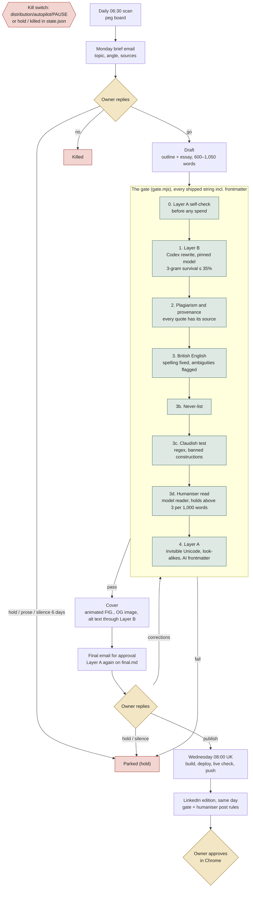

# distribution/line/

The weekly essay line: one essay a week on signal-to-noise.co with no human
in the loop except two emails. Full design in
[`../../docs/specs/2026-09-09-weekly-essay-line-design.md`](../../docs/specs/2026-09-09-weekly-essay-line-design.md);
this is the operational reference.

## Prerequisites

Nothing to start by hand. Since 12 Oct 2026 both watermark layers live in the
repo:

- **Layer A** (`scripts/line/layera.mjs`) is pure Node: it removes invisible
  Unicode carriers (zero-width, bidi controls, tag characters, stray variation
  selectors, soft hyphens), turns odd spaces into plain ones, maps Cyrillic and
  Greek look-alikes inside Latin words back to Latin, and drops AI-provenance
  frontmatter keys (by key name only) and `data:` URIs. Emoji sequences,
  keycaps, £, accents and curly quotes are kept. `layera-corpus.test.mjs`
  proves it leaves every published essay alone.
- **Layer B** (`scripts/line/layerb.mjs`) rewrites through the Codex CLI on
  the owner's ChatGPT account, with the model pinned in `config.json`
  (`models.layerb`), never taken from `~/.codex/config.toml`. Each run
  measures how many of the original's 3-word runs survive (figures, names,
  quotations and links excluded); above 35% it retries once, then reports a
  warning in the gate report.

The `watermarks-remover` Docker service and its LaunchAgent
(`infra/co.signal-to-noise.watermarks.plist`) are no longer used by the gate.
They stay in `infra/` for auditing images by hand.

## How an essay is made and checked



Owner decisions are gold, checks green, stops red. The runner does one essay
per wake and never treats silence as consent.

## The weekly rhythm

The runner wakes at 06:30 and then hourly from 07:00 to 23:00 (`infra/co.signal-to-noise.essay-line.plist`; hourly since 14 Sep 2026 so a reply is seen within the hour).
Nothing happens between wakes, so every row below names the wake that does the work.

| When | What | Who |
|---|---|---|
| Daily 06:30 | Scanner refreshes the peg board | automation |
| Mon, the 06:30 wake | Brief email: topic, angle, why now, sources, peg score if any | automation |
| Mon, any hourly wake after | Reply "go" (proceed), "no" (kill), "hold" (park). Silence: nothing happens | owner, required |
| The wake that sees "go" | Draft, gate (Layer B, plagiarism, BrE, never-list, Layer A), cover and the "Final for approval" email, all in that one wake (about an hour) | automation |
| Until Wed 08:00 | Reply "publish", "hold", or corrections. No reply = hold. The final pins the slot to the coming Wednesday when sent before Wed 08:00 | owner |
| Wed, the 08:00 wake | Publish if approved — the first wake at or after the 08:00 UK slot. A late "publish" ships at the next hourly wake | automation |
| Mon 07:30 | Metrics pull (`co.signal-to-noise.metrics`) | automation |
| Wed, attended, after 08:00 | LinkedIn newsletter edition for the essay that just went live, same day as the canonical (owner's rule 15 Sep 2026: subscriber growth outweighs the indexing gap). Gate it beforehand, then paste and confirm in Chrome | owner + Claude in Chrome |
| Mon, attended | Readout, peg board, native post scheduled 08:00 UK | owner + Claude in Chrome (`.claude/skills/essay-line-monday/`) |

## The two-email rules

- **Monday brief — silence means no action.** Only the exact word `go`
  moves the essay on; the runner checks for it at every wake. `no` kills the
  essay; `hold` parks it. `ok` or `publish` does nothing and the owner is
  told so, once. Any other prose reply is **not** consent: the essay is parked
  with `hold: true`, the text is kept, and the owner is emailed once. A brief
  unanswered for six days is parked with one email, so it never blocks the
  next Monday's brief. (Changed 14 Sep 2026 from "silence means go" at the
  owner's instruction.)
- **Tuesday final — silence means hold.** Only the exact word `publish`
  ships. An `ok` reply does nothing and the owner is told so, once. `hold` or
  `no` parks or kills it. Any other text is taken as corrections, which
  re-enter the gate before a new final is sent.

## Kill switch and per-essay hold/kill

- `distribution/autopilot/PAUSE` (a file, gitignored) halts every job: the
  runner logs `PAUSE present` and does nothing. Remove the file to resume.
- `state.json` `hold: true` parks one essay; `killed: true` stops it for
  good. Both are checked before any other logic in `advance()`.
- Three things set `hold` for you: three failures at the same action, a gate
  that returns `fail` (before or after corrections), and a final left
  unanswered for seven days (`final_expired_at` records that you were told,
  once). Clear `hold` by hand once the cause is fixed — **and for a gate fail,
  also set `stage` back to `drafted`**, because a `gated` essay with
  `gate_verdict: 'fail'` has no next action whatever `hold` says, so clearing
  `hold` alone leaves it sitting there. Which file goes back in front of the
  gate depends on how it failed: see **Recovery** below.
- `stage: brief-sending` means the send crashed part-way: the owner may or may
  not have the email. The runner deliberately does nothing with it — check the
  inbox, then set the stage to `briefed` (with the message id) or delete the
  directory and let Monday come round again.

## Recovery

A gate fail parks the essay in `stage: gated` with `gate_verdict: "fail"`, and
that combination has no next action whatever `hold` says. Clearing `hold` alone
never restarts it: the stage has to go back to `drafted`, and the gate always
re-reads `draft.md`. `state.json` `gate_fail_origin` records which of the two
cases you are in, and the mail that parks the essay repeats the one line.

- **Original gate fail** (`gate_fail_origin: "draft"` — the Monday-to-Tuesday
  gate). Fix the cause (edit
  `draft.md`), then in `<slug>/state.json` clear `hold` and set
  `stage: "drafted"`. `draft.md` is re-gated from the top.
- **Corrections-round fail** (`gate_fail_origin: "corrections"` — the owner
  replied with corrections and the re-gate failed). The corrected text is saved
  as `<slug>/corrected.md`; `draft.md` is still the pre-corrections text, so
  recovering the first way silently throws the owner's edits away. Instead: copy
  `corrected.md` over `draft.md`, then clear `hold` and set `stage: "drafted"`.
  The corrected text is then re-gated in full.

Both routes go `drafted → gate → cover → send-final`, so the cover skill runs
again and rewrites `<slug>/cover-alt.txt`. An alt the owner corrected in the
same round does not survive the recovery — re-state it in the next corrections
reply, or edit `cover-alt.txt` by hand after the cover step.

## Where state and logs live

- Per-essay state: `_sources/staging-articles/<slug>/state.json` plus
  `brief.md`, `OUTLINE.md`, `draft.md`, `gate-report.md`, `final.md`,
  `cover-alt.txt`, and `corrected.md` after a corrections round (gitignored,
  local-only).
- Peg board: `distribution/line/peg-board.json` and `.md`.
- Script log: `~/Library/Logs/signal2noise-essay-line.log`.
- launchd stdout/stderr: `~/Library/Logs/signal2noise-essay-line-launchd.log`.

## Running a stage by hand

```bash
node scripts/line/scan.mjs [--dry]                                    # refresh the peg board
node scripts/line/brief.mjs [--dry]                                   # this week's brief (no slug — it picks the topic)
node scripts/line/draft.mjs <slug>                                    # outline + draft from the brief
node scripts/line/gate.mjs <in.md> <out.md> [--report <path>] [--skip-layerb]   # Layer B, plagiarism, BrE, never-list, Layer A
node scripts/line/publish.mjs <slug> [--dry]                          # commit, build, deploy, verify
node scripts/line/runner.mjs [--dry] [--now <ISO>]                    # one full tick — the launchd entry point
```

`cover.mjs` and `final.mjs` export functions (`makeCover`, `sendFinal`,
`readFinalReply`, `applyCorrections`) called by the runner; they have no
standalone CLI, so exercise them through `runner.mjs` or the test suite.

## Tests

```bash
npm run test:line   # node --test scripts/line/test/*.mjs — no network, no paid model, no spend
```

## Humaniser weekly learn

Every Monday at 07:45 (`infra/co.signal-to-noise.humaniser-learn.plist`)
`scripts/line/humaniser-learn.mjs` reads the essays published since its last
run, lines up each one against the gate output it shipped from
(in `_sources/staging-articles/<slug>/`: the newest raw Layer B output
`gated.layerb*.md`, else the oldest whole `*.gated.md` that differs from the
published text, else `gated.md`, else `final.md`; when every gated version
matches what shipped, the essay is noted as having no owner edits) and treats every sentence the owner changed as evidence. A model
sorts each change into fact fix, owner taste or machine tell. Machine tells
become proposed register pairs (formal → plain, `source: "learned"`) and
proposed humaniser tells. A register pair the owner himself uses more than
0.3 times per 1,000 words in his hand-written essays is rejected, and an
existing pair whose owner rate has risen above that is proposed for removal.
Rates, inflections and the corpora come from `scripts/line/register.mjs`
(the same code as `register.mjs measure`); a learned pair is written to
`scripts/line/data/register.json` with `source: "learned"`, and existing
pairs keep their `forms` and `except` fields. "Line-written" means every
ledger slug plus any slug with a staging folder (`lineSlugs()` in
`register.mjs`), for both.

The job works in a throwaway git worktree off `origin/main`, writes
`distribution/line/humaniser-proposals/YYYY-MM-DD.md`, and opens a PR titled
"Humaniser weekly proposals YYYY-MM-DD" with a macOS notification carrying
the link. It never merges.

- **Approve:** merge the PR. Nothing changes the checker before that.
- **Reject:** close the PR. Silence changes nothing either.
- **Nothing to propose:** no PR; the proposals file goes to the gitignored
  `_sources/humaniser-learn/YYYY-MM-DD.md`.

The repo is public and the gated text is unpublished, so the proposals quote
only the published sentence and show the changed words of the draft
(`acquired → bought`); a filter refuses any output that carries five words in
a row from the draft, and the never-list check runs on everything written.
An essay already learned from is marked with
`_sources/staging-articles/<slug>/humaniser-learn.json`.

```bash
node scripts/line/humaniser-learn.mjs --dry                 # evidence only: no model, no git, nothing written
node scripts/line/humaniser-learn.mjs --since 2026-10-01    # redo a window, ignoring the markers
```

## Calibration note

The scanner (`scan.mjs`) runs score-only (no preempting the queue) until
`calibration_until` in `distribution/line/config.json` (`2026-10-07`); until
then the peg board is shown on Mondays for calibration but never jumps the
seed queue.

## Operational caveats

- **The Mac must stay awake for a wake.** launchd fires a missed wake inside the
  next Power Nap dark wake, which lasts about 46 seconds before the Mac returns
  to Maintenance Sleep; a headless Claude run cannot finish in those slivers
  (the first live brief, 14 Sep 2026, timed out this way with the output
  complete three seconds before the kill). The plist therefore runs the runner
  under `/usr/bin/caffeinate -s -i`, which holds the machine awake for as long
  as the runner runs. It does not wake a sleeping Mac; the wake still happens
  at the next dark wake, up to five minutes late.

- **The morning window.** The Monday brief and the daily scan both fire only
  in the 06:00–12:00 local window (`tick()`'s own guard, independent of the
  launchd wake times). A Mac first woken after noon on a Monday produces no
  essay that week — there is no evening catch-up.
- **Brief retries are capped at two per week.** With hourly wakes, a brief
  that fails after its paid step would otherwise be retried at 07:00, 08:00 …
  11:00. `runner.mjs` records failed attempts in
  `_sources/staging-articles/.brief-attempts.json` and stops after two; the
  second failure email says so and gives the manual command. The daily scan
  has no such cap (it runs once a day by board date).
- **One runner at a time.** A wake now chains draft, gate, cover and the
  final, which can take an hour, so the next hourly wake may arrive while a
  run is still going. launchd never starts a second instance of a running
  label: that trigger is dropped and the following one fires on schedule.
  Nothing is lost, because every stage is re-derived from state on the next
  wake.
